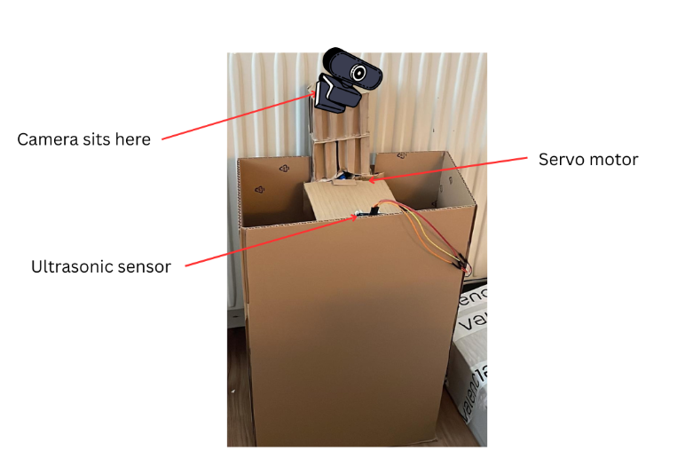
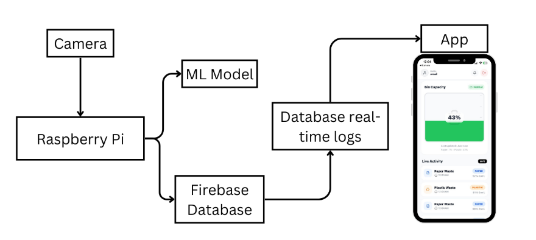
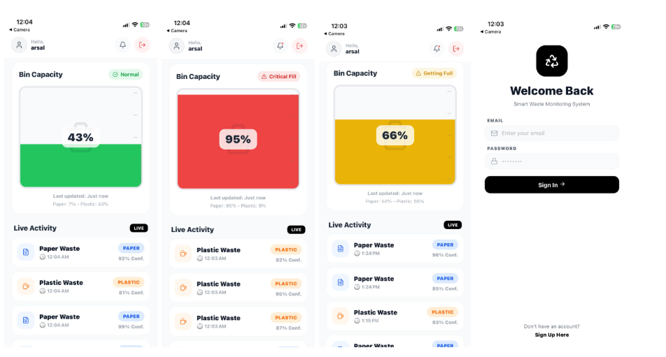

# AI-Powered Smart Waste Sorting Bin

An AI-powered smart waste sorting system that automatically classifies
and sorts paper and plastic using real-time image recognition.

The system was developed as a university group project at Stockholm University.

## Overview

The system uses a Raspberry Pi 5 as the main processing unit. When waste
is detected, a camera captures the item and a machine learning model
classifies it as either paper or plastic.

Based on the classification result, a servo motor directs the waste into
the correct compartment. Classification results and sensor data are also
sent to Firebase and displayed in a React Native mobile application.

## Technologies

- Python
- Raspberry Pi 5
- TensorFlow Lite
- MobileNetV2
- OpenCV
- Firebase
- React Native / Expo
- TypeScript
- Ultrasonic sensors
- Servo motor

## System Architecture

1. An ultrasonic sensor detects a waste item.
2. The camera captures images of the item.
3. The Raspberry Pi preprocesses the image.
4. MobileNetV2 classifies the item as paper or plastic.
5. The servo motor directs the item to the correct compartment.
6. Classification and sensor data are sent to Firebase.
7. The mobile application displays real-time information.

## Project Structure

    backend/       Firebase communication
    hardware/      Raspberry Pi and servo control
    ml/            Machine learning model and inference
    mobile_app/    React Native monitoring application

## Machine Learning

The classification system uses MobileNetV2 and was trained to distinguish
between paper and plastic waste.

The trained model was converted to TensorFlow Lite so that inference could
run directly on the Raspberry Pi 5.

## Mobile Application

The mobile application was developed with React Native and Expo.

It connects to Firebase and allows users to monitor classification results
and bin information in real time.

## Authors

- Muhammad Arsal
- David Singhateh
- Diana Noran

## Note

This project was developed as a university prototype and currently focuses
on classification of paper and plastic waste.

## Prototype

## System Architecture

## Mobile Application

